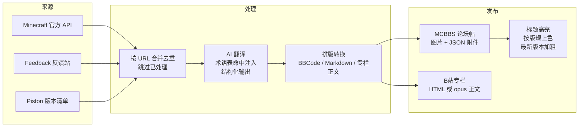

<div align="center">


# 矿译通

**MineCraft Translation ToolKit**

Minecraft 官方资讯 → 中文社区，一条自动化流水线

[](https://github.com/jiubook/MCTTK/actions/workflows/ci.yml)
[](https://github.com/jiubook/MCTTK/actions/workflows/release.yml)
[](#)
[](https://github.com/jiubook/MCTTK/pkgs/container/mcttk)
[](https://www.gnu.org/licenses/gpl-3.0.zh-cn.html)
[](https://qm.qq.com/cgi-bin/qm/qr?_wv=1027&k=cWimZfaBzg4kpFrpt9G9yErBqBuarD6z&authKey=sjcLaLvI%2B2fvv6sAIugP4Jj1Z8HsnJB%2FZ1rya%2Bfa%2BTWUxfh1CL0x3AOAC3hbPORm&noverify=0&group_code=1020121333)

</div>

## 项目简介

Minecraft 的官方资讯散落在好几个来源：**1.官网 API、2.Feedback 反馈站、3.版本清单**

而每种新闻在中文社区又有各自的译名习惯、排版模板和发帖要求。

`（Java 快照 / 预发布 / RC / 正式版、基岩版更新 / 测试版、块讯、时评）`

长期维护这类资讯，真正耗时的往往不是翻译那几段，而是反复的采集、术语核对、格式调整、发帖以及之后的标题维护。

---

矿译通把这些重复劳动串成一条流水线自动跑：

**抓取 → 术语约束下的 AI 翻译 → 按类型排版 →发布到 MCBBS 与 B站专栏 → 按版规维护标题高亮**

内容维护者只需要关心译文质量和资讯本身。

## 工作流程



失败的文章不会被记成「已处理」，下一轮自动重试；首次运行会把现有新闻全部标记为已处理，
避免一次性刷屏 —— 这两条是无人值守运行的底线。

## 核心特性

### 采集与处理

- **三类来源**：官方 API、Feedback 反馈站（走 Zendesk 公开 API，失败回退页面解析）、
  Piston 版本清单（补齐 Java 版本日志）
- **URL 级去重**：`output/.state.json` 记录处理状态，同一篇文章不会重复翻译、重复发布
  （前提是同一个输出目录只跑一个实例；并发跑同一目录，或发帖成功后、记账前进程被杀，
  这一条不成立）
- **失败可重试**：解析或翻译失败只记次数、不标记已处理，下一轮接着做，超过上限才放弃
- **首次运行保护**：第一轮把所有现有新闻标为已处理，只处理此后新增的内容

### 翻译与排版

- **术语一致**：手写覆盖层 + 自动词表层，按文章内容**命中注入**相关术语，不给模型塞整本词典
- **长文可靠**：分批并发 + JSON Schema 结构化输出；返回被截断时自动拆分重试，而不是整批丢弃
- **按类型排版**：Java 快照 / 预发布 / RC / 正式版、基岩版更新 / 测试版、块讯 / 时评
  各套各的头部与尾部模板（`config/modules_config.json`）

### 发布与状态管理

- **双平台**：MCBBS 论坛帖（含验证码识别、图片与 JSON 附件）与 B站专栏（两套正文渲染器：
  老接口 HTML / 新版编辑器 opus 段落）
- **标题高亮**：按版规「二、高亮设定」自动上色；帖子还在审核时先落一条待办，过审后才动手，
  失败按次数与时限放弃，不会无限重试
- **最新版本加粗**：Java 版 / 基岩版 × 正式版 / 测试版 共四条版本线，各自只保留最新一篇加粗
- **可对账**：`--highlight-status` 逐条比对「本地记录 vs 站点现状」，`--dry-run` 可预演整条链路

## 效果展示

### 翻译：从官方资讯到中文帖子

以 `news_Minecraft_26.4_Snapshot_9` 为例（内容取自 `output/` 里的真实产物）：

| | 内容 |
| --- | --- |
| 原始标题 | `Minecraft 26.4 Snapshot 9` |
| 发布标题 | `Minecraft 26.4 快照 9 [AI翻译]` |

> **原文**
>
> 26.4 Snapshot 9 is here, bringing data-driven dispensers, Vulkan as the default graphics
> backend, and a new setting to fine-tune your fog. We've also made improvements to keyboard
> navigation and narration, alongside a few other tweaks and fixes!

> **译文**
>
> 26.4 快照 9 来了，带来了数据驱动的发射器、将 Vulkan 设为默认图形后端，以及一项可微调雾效的
> 新设置。我们还改进了键盘导航与旁白功能，并附上其他一些调整与修复！

### 发布：幻翼块讯版面上的真实结果

下面这些帖子是工具自动发出、并按版规自动设置高亮的（链接可直接打开）：

| 帖子 | 分类 | 标题样式 |
| --- | --- | --- |
| [Minecraft 26.4 快照 9 [AI翻译]](https://www.mcbbs.co/thread-6808-1-1.html) | Java版资讯 | 🟩 `#3C9D40` + **加粗** |
| [Minecraft Java版 26.3 [AI翻译]](https://www.mcbbs.co/thread-6336-1-1.html) | Java版资讯 | 🟥 `#EE1B2E` + **加粗** |
| [Minecraft 预览版 26.70.26 更新日志 [AI翻译]](https://www.mcbbs.co/thread-6812-1-1.html) | 基岩版资讯 | 🟩 `#3C9D40` + **加粗** |
| [Minecraft: 基岩版 26.62 热修复更新日志 [AI翻译]](https://www.mcbbs.co/thread-6737-1-1.html) | 基岩版资讯 | 🟥 `#EE1B2E` + **加粗** |
| [TwitchCon 揭晓 2027 年首个游戏更新的特色内容 [AI翻译]](https://www.mcbbs.co/thread-6816-1-1.html) | 块讯 | 🟪 `#EC1282`，不加粗 |

四条版本线（Java 正式版 / Java 测试版 / 基岩版正式版 / 基岩版测试版）各有一篇加粗；新版本
发出来后，旧的会自动取消加粗 —— 这是版规「最新版本加粗」在 Discuz 里的实现方式。
每次设置高亮都会在站上留一条「本主题由 newspaper 设置高亮」的版主记录，这是 Discuz 的机制。

### 发布：B站专栏

同一份产物不只发论坛，也能直接投成专栏（`bilibili.renderer: opus` 走新版编辑器的段落正文）：

| 专栏 | 分类 |
| --- | --- |
| [Minecraft 预览版 26.70.26 更新日志 [AI翻译]](https://www.bilibili.com/opus/1271848285796040706) | 基岩版资讯（测试版） |
| [Minecraft 26.4 快照 9 [AI翻译]](https://www.bilibili.com/opus/1271709700077912068) | Java版资讯（测试版） |
| [Minecraft 26.4 快照 8 [AI翻译]](https://www.bilibili.com/opus/1270805265844797465) | Java版资讯（测试版） |

专栏和论坛帖走两套互斥的正文渲染器（`bili/html.py` / `bili/opus.py`）：段落边界一致，但
B站那套会把原文对照刷成灰字放在译文下面、把外链降级成「文字（URL）」—— 站内点外链会先弹
「离开 B站」的拦截页，所以只保留项目署名的链接。投稿前可以用 `tools/preview_bili_html.py`
在本地预览排版。

## 快速开始

**环境**：Python 3.13 + [uv](https://docs.astral.sh/uv/)；要容器化部署见
[docs/DOCKER.md](docs/DOCKER.md)。

```bash
# 1. 装依赖（可选扩展：--extra captcha 验证码识别 / --extra feedback Feedback 抓取）
uv sync --extra captcha --extra feedback

# 2. 配置：复制模板，然后改 openai_compat 的 host / model，再填 API Key 与账号
cp config/config.sample.json config/config.json     # Windows: copy
cp .env.sample .env                                  # 放 OPENAI_API_KEY / MCBBS_USERNAME / MCBBS_PASSWORD
#   模板里的 host 是 api.example.com 占位符：main.py 见到 example 会当成
#   「翻译 API 未配置」直接退出，必须换成自己的服务商地址

# 3. 先空跑看看能抓到什么（不翻译、不发帖、不写状态）
uv run python main.py --dry-run

# 4. 正式跑一轮：抓取 → 翻译 → 转换 → 发布
uv run python main.py
```

跑完看两处：`output/` 下的产物（`news_*.json` / `.txt` / `.md` / 头图）与
`logs/mcttk_YYYY-MM-DD.log`（每轮抓了多少、翻了几篇、发到哪）。

```bash
uv run python main.py --scrape-only    # 只抓取 + 翻译，不发帖
uv run python main.py --post-only      # 只发 output/ 里还没发的
docker compose up -d --build           # 容器化运行，默认每小时一轮
```

## 文档

| 文档 | 内容 |
| --- | --- |
| [CONTRIBUTING.md](CONTRIBUTING.md) | 贡献指南：环境与命令、代码规范、测试与验证、PR 标准、发版流程 |
| [docs/USAGE.md](docs/USAGE.md) | 完整用法：全部配置项、CLI 参数、日志、新闻来源、词汇表、注意事项 |
| [docs/DOCKER.md](docs/DOCKER.md) | Docker / 服务器部署、离线部署、镜像与版本说明 |
| [docs/archive/](docs/archive/) | 历史设计与评审记录 |

## 注意事项

- **配置与凭据**：`config/config.json`、`.env` 都在 `.gitignore` 里，请从模板复制；
  API Key 与论坛密码建议只放在 `.env`。`http.verify_ssl` 默认开着，别为了绕过证书错误关掉它
  （翻译请求带着 API key），优先配 `http.ca_bundle`
- **无授权不要真跑发布**：`--dry-run` 只探测（不翻译、不发帖、不写状态）；想连发布链路一起
  试又没有真站点，就把配置里的 `mcbbs.enabled` / `bilibili.enabled` 关掉 —— 只换 `--dir`
  换输出目录**不会**阻止往线上论坛发帖
- **状态文件**：`output/.state.json`（已处理的新闻）、`.posted.json`（已发布的）、
  `.posted_bili.json`（已投稿的）、`.mcbbs_threads.json`（高亮追踪）—— 删除语义见
  [docs/USAGE.md](docs/USAGE.md#注意事项)。它们都**不入库**，跟着部署的 `output` 卷走：
  换机器或重建卷之前把整个 `output/` 备份出来（只留状态、丢了产物，发布失败的文章就没有
  可补发的产物；状态丢了则每一轮都被当成「首次运行」，一篇都不会发）

## 许可证

本工具以 [GPL-3.0](https://www.gnu.org/licenses/gpl-3.0.zh-cn.html) 协议发布。

AI 翻译作品以 [CC BY-SA 4.0](https://creativecommons.org/licenses/by-sa/4.0/deed.zh-hans) 协议发布。
